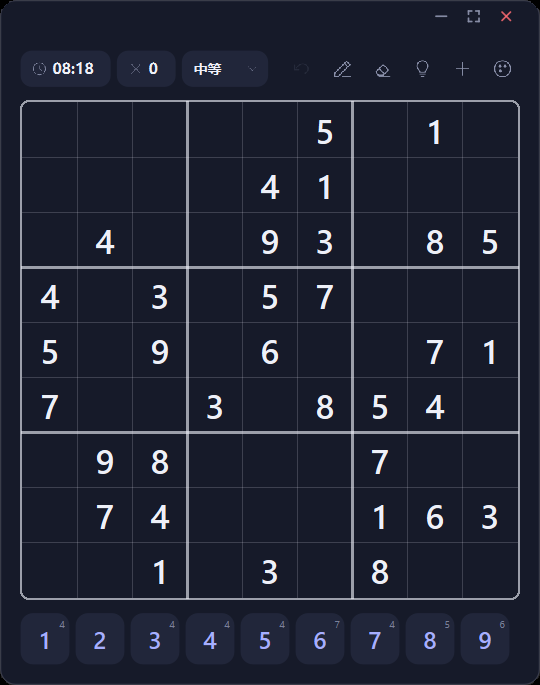
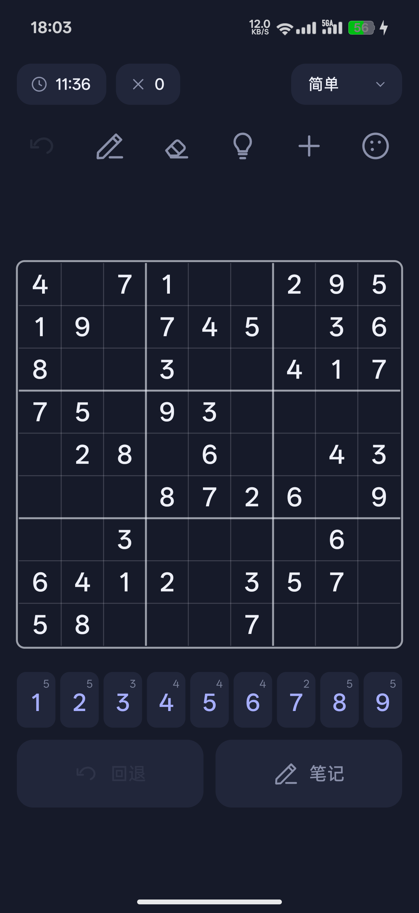
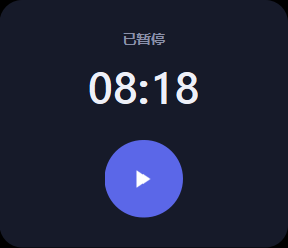

# Sudoku

一套同一份设计语言的数独，两个端各自原生实现：

- **桌面端**：Qt 6 Widgets / C++（纯 `QPainter` 自绘，无 QML、无图片资源，图标全部矢量路径绘制）
- **Android 端**：原生 `View` 全画布渲染（纯 Java，**不依赖 Gradle / AndroidX / 任何 Maven 依赖**，用 `aapt2 + javac + d8 + zipalign + apksigner` 手工打包）

两端共用同一套配色令牌、同一套圆角与排版尺度（Android 侧用 `u = boardSize / 400` 做 dp 归一化，与桌面端 400px 逻辑棋盘 1:1 对应）。

| 桌面端 | Android 端 |
| --- | --- |
|  |  |

桌面端暂停态（点左上角计时器触发）：



---

## 功能

- **出题**：回溯生成完整解 → 随机挖洞 → 唯一解校验（`Game.makePuzzle` / `Game::makePuzzle`）
- **四档难度**：简单 44 个已知数 / 中等 34 / 困难 29 / 专家 25
- **笔记（候选数）**：单元格内以 3×3 微网格记录候选数字，落子后自动清理同行同列同宫候选
- **冲突高亮**：同行、同列、同宫重复数字即时标红
- **提示**：每局 3 次
- **回退**：完整撤销栈，支持逐步回退到开局
- **暂停**：两种语义分开处理（见下）
- **六个主题**，每个主题自带深/浅两套调色板：`Classic` / `Paper` / `Night` / `Garden` / `Contrast` / `Arcade`
- **状态持久化**：桌面端写注册表/配置，Android 端写 `SharedPreferences`，冷启动恢复到中断局面

### 暂停模型（两端一致）

| 触发 | 行为 | 返回时 |
| --- | --- | --- |
| 切后台 / 窗口失焦 / 最小化 | 静默暂停（自动暂停） | **自动继续**，不弹任何界面 |
| 主动点左上角计时器 | 暂停 + 显示暂停浮层 | 保持暂停，等你点浮层里的三角 |

区分手段是一个 `autoPaused` 标志：只有自动暂停才会在回到前台时被自动解除；用户主动打开的暂停浮层会一直留着。
暂停浮层里的播放三角按包围盒中线摆放（`6.8 → 17.2`，中线 12），使视觉重心与圆心重合，而不是几何重心偏移的原始三角形。

### Android 布局

数字键盘不再贴屏幕底部，而是跟在棋盘下方（`gapKey + 46dp + gapAct + 56dp` 与棋盘共同组成一个垂直居中的整组）。
键位下方是动作条：左「回退」、右「笔记」（选中态文案变「笔记中」，底色用 accent 与背景混合）。
笔记按钮放在右下角，方便右手单手切换。

### 桌面端快捷键

| 键 | 动作 |
| --- | --- |
| `1`–`9` | 填入数字 |
| `Backspace` / `Delete` / `0` | 清空当前格 |
| `N` | 切换笔记模式 |
| `H` | 提示 |
| `Ctrl+Z` | 回退 |
| 方向键 | 移动选中格 |

---

## 目录结构

```
Sudoku/
├── qt/                       桌面端（Qt 6 Widgets + C++）
│   ├── main.cpp              入口
│   ├── mainwindow.{h,cpp}    主窗口：布局、暂停状态机、快捷键、持久化
│   ├── game.h                规则内核：生成/挖洞/校验/撤销栈/计时
│   ├── palette.h             主题与调色板（深/浅两套）
│   ├── widgets.{h,cpp}       自绘控件：Board / Pill / IconBtn / KeyBtn + 矢量图标
│   ├── resources.qrc · app.rc · icon.ico
│   ├── sudoku.pro            动态链接构建
│   ├── sudoku_static.pro     静态链接构建（单文件 exe）
│   └── tools/                桌面端验证脚本（PrintWindow 截图 / 自动化点击 / 冷启动）
│
├── android/                  Android 端（原生 View + Java）
│   ├── AndroidManifest.xml
│   ├── src/com/buddy/sudoku/
│   │   ├── MainActivity.java 生命周期 → 自动暂停/自动恢复
│   │   ├── SudokuView.java   全画布渲染：布局、绘制、命中测试、手势
│   │   ├── Game.java         规则内核（与 qt/game.h 对齐）
│   │   ├── Palette.java      主题令牌
│   │   └── Prefs.java        局面持久化
│   ├── res/                  图标与主题资源
│   ├── build_apk.sh          手工打包脚本（见下方说明）
│   ├── test/                 纯 JVM 单元测试（规则/唯一解）
│   └── tools/                布局测量、截图取点、谜题校验等辅助脚本
│
├── verify/                   规则验证工程（Qt Test 风格，校验题面唯一解）
├── scripts/
│   ├── build.ps1             桌面端动态构建 → bin/Sudoku.exe
│   ├── build_static.ps1      桌面端静态构建 → bin/Sudoku.exe（单文件）
│   ├── annotate_*.py         布局标注图生成
│   └── make_shortcut.py      生成桌面快捷方式
├── docs/                     README 用的截图（docs/dev/ 为设计稿，不入库）
└── .gitignore
```

---

## 构建

### 桌面端（Windows + Qt 6.11.1 mingw_64）

需要：Qt 6.11.1 `mingw_64`、MinGW 13.1（Qt 自带 `Tools/mingw1310_64`）。

```powershell
# 动态链接（需要 Qt DLL，脚本会调用 windeployqt）
powershell -File scripts\build.ps1

# 静态链接（单文件 exe，需静态版 Qt）
powershell -File scripts\build_static.ps1
```

脚本可在任意目录调用，路径由 `$PSScriptRoot` 自身推导。工具链默认写死为：

```
D:\Qt\6.11.1\mingw_64\bin
D:\Qt\Tools\mingw1310_64\bin
```

换机器时用环境变量覆盖，不必改脚本：

| 变量 | 作用 |
| --- | --- |
| `SUDOKU_QT_BIN` | Qt `bin` 目录 |
| `SUDOKU_MINGW_BIN` | MinGW `bin` 目录 |
| `SUDOKU_QT_STATIC` | 静态版 Qt 安装前缀（`build_static.ps1` 用） |

输出：`bin/Sudoku.exe`，脚本末行打印 `BUILD_OK <字节数>`。

### Android

需要 JDK 17 + Android SDK（build-tools 35.0.0 / platforms/android-35）。默认工具链在 `/d/android-toolchain`，可用 `TOOLCHAIN` 环境变量覆盖。

```bash
bash android/build_apk.sh
```

构建链路（不装 Android Studio、不用 Gradle）：

1. `aapt2 compile` 资源 → 扁平包
2. `aapt2 link` 资源 + 清单 → `base.apk`（含资源表与 `R.java`）
3. `javac` 源码 + `R.java` → `.class`
4. `d8` `.class` → `classes.dex`
5. `jar uf` 把 dex 塞进 apk
6. `zipalign` 4 字节对齐
7. `apksigner` v1+v2+v3 签名

输出：`dist/Sudoku.apk`。首次运行会自动生成 `keystore.jks`（已在 `.gitignore` 中，不入库）。

安装：

```bash
/d/android-toolchain/sdk/platform-tools/adb.exe install -r dist/Sudoku.apk
```

---

## 实现说明

- **零图片资源**：所有图标（齿轮、灯泡、回退、笔记、播放三角、对勾）都是 `QPainterPath` / `Path` 里的路径指令，按 24×24 逻辑网格书写，按目标尺寸缩放绘制。因此任意 DPI 下都锐利，也省掉多套 PNG。
- **两端布局同构**：`SudokuView.computeLayout()` 与 `Board`/`Pill` 的几何推导逐项对应，改一处需要同步核对另一处（`qt/tools/` 与 `android/tools/` 里各有一份取点脚本用于交叉验证）。
- **命中测试独立于绘制**：绘制时把每个可点区域塞进 `hits` 列表，`activate()` 按 `kind` 分发；`KIND_ACTBAR` 只负责按压反馈，实际动作复用 `undo` / `notes` 的既有分支。

---

## 许可

个人项目，未附许可协议。
